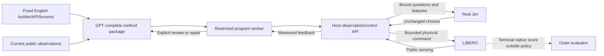

# GPT/Jev complete-method framework

Current evidence: after generic identity/correspondence guidance, an archive-
assisted GPT full rewrite completed hard13with native success
(17GPT/88real Jev/264steps), no same-scene source repair, and4actual unindexed
envelope observations. [Complete unedited method and Jev protocol](../../artifacts/gpt-jev-correspondence-method-20261025/METHOD.md)
are preserved; exact-source zero-repair native3/3passed(13,16,17). Fixed18/19are running. Init16native=true but completion_proposed=false from final visual uncertainty; both statuses remain unchanged. The cohort is incomplete; one Jev retry has unknown usage.
Previous5e and a18sources succeeded during acquisition but failed fresh exact
replay. Earlier5/5frozen evidence remains limited to those initial states.
Failures and costs remain separate in the [continuation record](../../LOGS/2026-10-25-gpt-jev-stability.md).
Stable reuse, independent fresh synthesis and net efficiency remain unestablished.

## Active program interface v2

Optional fresh synthesis can use the host's staged-design mode. The
[design-stage instructions](gpt_jev_design_v1.txt) first request a bounded,
strictly typed six-field architecture, saved as a proposal without execution.
The next request materializes the same complete four-string method described
below, with current runtime evidence and explicit design provenance. Both calls
count against the GPT budget; staged design/code/repair requests have900second
ceilings, while visual review keeps its existing deadline. No duplicate earlier
images are appended to the immediate same-frame materialization. This mode is
separate from archive-assisted revision and is not combined with method reuse.
Fifteen offline production-planner/real-CLI checks passed, with zero model calls
or physics. The actual design stage subsequently completed, but full-code
generation timed out without an executable method; its failure and unknown usage
are [retained](../../artifacts/gpt-jev-staged-synthesis-20261025/README.md).

The actual builder is [gpt_jev_method_v2.txt](gpt_jev_method_v2.txt), supplied with
the [exact API manual](gpt_jev_program_api_v2.md) and
[generic development lessons](gpt_jev_method_lessons_v2.txt). Runtime task language,
images and public robot state are separate data. The fixed files contain no task
IDs, target coordinates, grasp trajectory or object-specific command recipe.

Generated or repaired methods must declare `api.review(..., fields=...)` for
every visual review. The [review contract compiler](../scripts/gpt_jev_review_contract.py)
turns concise type/enum declarations into strict function-tool parameters and
validates actual returns without coercion. Untouched explicitly selected archive
methods retain the legacy interface. Schema validity is separate from observation
truth and physical task success. Tool-schema numeric constraints stay exact;
model data uses the documented six-significant-digit wire representation.

GPT submits a complete `main(api)` source plus its explanation, interface and Jev
protocol. It owns observation processing, phase logic, geometric parameters,
Jev questions, bounded control leases, effect checks and recovery. The
[host](../scripts/run_gpt_jev_program.py) validates the package and runs it in a
[separate restricted worker](../scripts/gpt_jev_program_worker.py). Exact local
patches are assembled into a complete retained source before execution. A repair
starts a new Python namespace in the same physical scene; it does not reset motion.

The harness supplies public RGB-D/calibration, own robot geometry, finite-choice
Jev RPC, bounded OSC commands, observation reviews and a
[generic RGB-D patch registration primitive](../scripts/jev_rgbd_tracking.py).
The candidate worker also preloads a [pure numerical geometry library](../scripts/gpt_jev_geometry.py)
as `geo`; the exact manual lists its operations. It computes caller-selected
geometry without selecting observations, accepting a task, or controlling motion.
Its analytical and sandbox checks passed; native cold-builder evaluation is
tracked separately in the [continuation record](../../LOGS/2026-10-25-gpt-jev-stability.md).
It supplies no hidden object pose, segmentation identity, contact oracle, goal
predicate, task-dispatch branch or prewritten grasp/transfer policy. Every physical
update invokes real Jev, and raw choices and dispatched actions are retained.
Jev does not see dictionary question IDs: the compiler explicitly binds each
axis question to its state selector. The manual declares magnitude/deadband rules.

Native LIBERO evaluation is terminal and isolated from the generated method.
Executable source, reached poses, a tracked patch and a completion proposal are
separate from task success. Development failures, source revisions and acquisition
costs remain part of the evidence. One repeatedly observed development scene
reached native success after three same-scene GPT repairs. The first frozen
new-init probe failed during transfer tracking. A spatial feature-budget fix then
completed the same init and one frozen unused init with the unchanged method and
no repairs. A successful same-init wire comparison reduced completed-response
GPT inputs by 19.1%, but unknown retry usage prevents a full GPT cost comparison;
elapsed time was effectively unchanged. Multi-task stability remains untested.
The final fresh-builder request, with no archived task source, timed out at 1800
seconds before method delivery. Stable fast cold generation is not validated;
repair and reuse of a validated method are supported. A post-test absolute relay
deadline fix passed local fake-stream checks only. See the
[complete-method development report](../../LOGS/2026-10-24-gpt-jev-program.md).

October25 continuation: the exact previously generated source passed the
predeclared five unused initial states4-8 with native5/5 and zero source repairs,
30 GPT reviews /432 real Jev calls /1296 policy steps. This is small-scale reuse
reliability on one task. The distinct geo-assisted cold method delivered source
but failed after two GPT patches at23 Jev /69 steps. Precise partial-measurement,
historical-data ownership and control-receipt types have since been clarified;
independent cold and revision tests continue. See the
[continuation record](../../LOGS/2026-10-25-gpt-jev-stability.md). Completed token
totals exclude known unknown-usage retries; no full-cost or speedup claim follows.

Later typed development results: a fresh method, with no previous source input,
reached native success after one same-scene GPT patch (17 GPT /107 real Jev /
321 steps). A separate GPT-led revision also succeeded (11/106/318). Both full
episode usages are known; neither establishes net token savings or speedup.
The [complete generated method and Jev input/output protocol](../../artifacts/gpt-jev-typed-method-20261025/METHOD.md)
are preserved verbatim with source and provenance. The frozen9a3e framework
then obtained native1/2 on independently generated init9/10, each with three
automatic source repairs. Both completion proposals were false: one stopped
above the receiver on unknown tracking, the other completed placement but lacked
tracking evidence for stability. Planned init11-13 were not admitted after the
failure. The next251104e6 candidate requires phase-local observation recovery
and exact helper-key checks; its declared larger budget is reported separately.
No outer-agent task-source edits are used.

The observation-recovery candidate exposed a deterministic pre-action worker
defect: ndarray reductions required a cached NumPy internal module through the
calling frame's builtins. The minimal worker fix returns only explicitly named,
already loaded NumPy internals; it does not invoke general imports. Offline
seccomp and unchanged-source recorded-RPC checks passed. The new independent
cold cohort uses this fix; its native outcome is tracked in the continuation
record, separately from the two interrupted zero-action cases.

The corrected fixed framework subsequently achieved native2/2 on independently
generated regression init9/10, with5/4automatic source patches and24GPT calls
each. Both completion proposals remained false; native scoring is authoritative,
and verification defects and all generation/recovery costs remain explicit.
The same framework subsequently completed unused init12 with the untouched
initial complete method:13GPT/109Jev/327steps, native and proposal both true.
Unused init11 also reached native success after5automatic patches, with a false
completion proposal. The final init13 failed before placement, so the completed
predeclared cold cohort is native4/5 and falsifies its all-five criterion.
All [completed methods and Jev protocols](../../artifacts/gpt-jev-cold-methods-20261025/README.md),
including [the untouched init12 method](../../artifacts/gpt-jev-cold-methods-20261025/init12/METHOD.md),
are preserved verbatim, separately from generic builder inputs.

Candidate618f559b is a separate frozen evaluation. Generic builder knowledge now
describes interval overlap, phase-local reference frames, measured-effect evidence
and acknowledged phase checkpoints. References persist across source repairs
within one physical episode, with creation provenance and a fresh tracking-quality
check required before reuse; new episodes still have empty memory. Its predeclared
sequence is regression init13 and unused14-17, each independent cold generation
with32GPT/5repairs/200Jev/600policy steps/9000seconds. Init14 completed with native/proposal both true,
17GPT/100Jev/300steps and zero source repairs. Init15 also completed with both
true after3automatic repairs,26GPT/107Jev/321steps. Regression13 then failed before closure after5repairs,31GPT/97Jev/291steps.
The candidate closed with native2/3 admitted;16/17 were not admitted. Its all-five
criterion is falsified. Its [complete initial method](../../artifacts/gpt-jev-continuity-methods-20261025/init14/METHOD.md) is preserved verbatim. These changes and the larger budget are
evaluated together, without claiming isolated causality or improved speed.



The same existing signed-in local Pro planner and separate authorized Jev routing
described below apply to v2. Neither Platform API credentials nor `caz/z` keys
are used. The v1 contract adapter remains available for comparison.

## Previous contract planner v1

The reusable prompt is `gpt_jev_planner_v1.txt`. It contains no task names,
task IDs, fixed manipulation recipes, demonstrations, or known trajectories.
Runtime task language and current RGB-D are separate inputs. Generated plans may
be task-specific: that is the planner's output, not a handwritten task policy.
This separation supports evaluation of generality; it does not establish it.

## Executable interface

`code/scripts/gpt_jev_contract.py` exports the exact `submit_plan` tool schema,
capability contract, recursive English-text check, data validator, and Jev request
builder. `code/scripts/run_gpt_jev_generic.py` interprets the resulting data.

1. GPT selects visible image anchors and their measurement patches.
2. Code measures median RGB-D depth and performs calibrated backprojection.
3. GPT stages specify a target expression, world rotation-vector adjustment,
   gripper requirement, minimum delivered steps, and visual review conditions.
4. At every control update Jev chooses all six motion signs, gripper action,
   and continue/advance/review/stop. Code supplies bounded magnitudes and OSC_POSE.
5. A local gate checks robot pose and command delivery only. GPT reviews actual
   before/after images for object effects, then regenerates a grounded local plan.
6. Native task evaluation is read only after policy termination.

No generated Python, `eval`, dynamic imports, arbitrary expression language,
task-ID dispatch, category/color segmentation heuristic, or physics preview is
used. The existing own-finger geometry helper supplies robot geometry only.
Visual-check strings are instructions for the next GPT review, not implemented
detectors. Checkpoint requests include only current/previous planning views and
the latest six acknowledged command receipts; complete raw receipts remain local.

## Limits and evidence

Depth patches may hit background, an occluder, or an unintended surface even if
depth is locally smooth. Anchor identity, occluded geometry, contact, retention,
collision avoidance, and completion are not certified by schema validation.
Anchors remain fixed until review; moving targets need renewed grounding.
The interpreter has no collision planner. Scope is bounded simulated manipulation.

Prompt and schema are frozen before selecting/running the first development
episode. One task tests integration and feasibility only. Generalization needs
held-out task families, objects, and layouts with no task-specific prompt edits.
Efficiency needs matched-success comparisons including all initial/review GPT
tokens, Jev tokens/calls, physical steps, failures, and elapsed time.

## Model routing

The planner uses the existing local signed-in ChatGPT transport, pinned to
`gpt-6-astra` / `xhigh`. It never uses a Platform API key. A separate user-authorized
Jev credential serves real `jev-1.13.0` at the official TypeSafe `/v1/systemone`
endpoint through the existing loopback relay. No OpenAI Decisions credential or
`caz/z` key is used. The remote executor accepts only the explicit port-7921
loopback relay, and stores request/response/dispatch records for auditing.

References: [OpenAI prompt engineering](https://developers.openai.com/api/docs/guides/prompt-engineering),
[Jev Choice](https://docs.typesafe.ai/primitives/choice),
[Jev 1.13 limitations](https://docs.typesafe.ai/model-jaggedness/jev-1.13).

## First development test, 2026-10-24

The fixed prompt and interpreter ran on company-server-2-ykj using LIBERO-Plus.
GPT generated all stages and anchors from runtime observations. The final episode
used seven GPT plans, 74 real Jev decisions and 222 control steps. All executed
choices matched their receipts, but GPT's `complete` claim disagreed with native
evaluation (`false`). This is executable integration evidence, not a successful
task result, a stability guarantee, a generalization result, or a token/speed gain.

See [the complete development report](../../LOGS/2026-10-24-gpt-jev-generic.md),
including the setup failure, zero-action review loop, and four-plan budget failure.
The tested control commit was `87516433`; the subsequent cancellation bookkeeping
fix does not change planning or action selection. No task recipe was added after
seeing the final failure. This adapter currently targets one LIBERO robot and
OSC_POSE; another robot needs a capability/observation/action adapter.


Current candidate0d15ab18 requires an explicit per-gate sufficient-evidence contract
in the complete interface, implements local reference handoff without unnecessary
old-shape registration, and adds bounded-memory/numerical-effect guidance. Visual
reviews distinguish local evidence scope, self-occlusion and observed obstacles.
The mathematical/execution API and limits are unchanged. Native evaluation is
predeclared13regression then unused16-19; only13is admitted, with32GPT/5repairs/
200Jev/600policy steps/9000seconds. Regression failure stops unused admissions.
This is a new frozen candidate, not a successful result yet.


The0d15ab18regression was interrupted by bridge502after three upstream TLS EOFs:
nativefalse,8GPT/19logical Jev/18dispatches/54steps. Four unused cases were not
admitted. The full interrupted method and all unknown usage remain retained.
A transport revision adds at most5identical non-actuating classification
attempts, an absolute queue/read/retry deadline, and active bridge source hashes.
11mock-upstream/real-loopback checks passed with no real models or physics.
Native regression must be rerun; static tests do not establish task reliability.


Candidate50432131 has restarted an independent cold regression13 with the same
model-visible builder/API/lessons as0d15and the new bounded classification
transport. Only13is admitted; unused16-19require regression success. Prior
transport-interrupted nativefalse and unknown attempts remain separate. Native
outcomes are pending. Two additional actual socket checks passed without models
or physics; they do not establish task success.


A real dictionary-evidence contract bug was reproduced: fixed-field summarization
sent seven nulls while the method's actual gap/phase/measurements were present.
Candidate2d710418 preserves arbitrary program_result fields and explicit bounded
log excerpts; the exact manual describes the new repair input. Eight actual-result
and schema checks passed (Native=N/A). Its independent cold13regression is now
the primary evaluation before unused16-19. The older504regression remains
unchanged and separate; its known contract bug prevents unused admissions there.
No task policy or trajectory was added, and no new native success is claimed.


[Project-local orchestration skill](../../.agents/skills/gpt-jev-method/SKILL.md)
provides a concise entry point to the canonical files and validation units. It
is outer-agent guidance, not automatically loaded planner context. Structure,
references and English/task-free checks passed; native success is separate.
The older504regression has now ended nativefalse/gpt_budget; its last source
was episode-bound. A separately labeled archive-assisted revision on2dremoves
old frame-specific observation shortcuts; independent cold validation continues.

## Reproduce the saved-run audit

The [audit tool](../scripts/audit_gpt_jev_run.py) checks raw Jev choices against
dispatches, bounds/acknowledged steps, complete source hashes against actual GPT
returns or declared reuse, exact relay responses, tool schemas, and all known or
unknown upstream usages. It reads the saved terminal native result and does not
rerun physics, infer hidden state or certify observation truth. Missing/ambiguous
request matches are explicit errors. Undelivered completed responses retain
their costs without inventing an executed method. Legacy untyped reviews stay
separate from strict visual reviews and strict designs.

The following command is one line. It performs a read-only audit of the actual
completed acquisition; replace the final directory for another completed run.

```bash
python3 -B code/scripts/audit_gpt_jev_run.py --no-write --bridge-dir code/runs/2026-10-25-gpt-jev-program/bridge-concurrent code/runs/2026-10-25-gpt-jev-program/cold12-revised-reg13
```

Omit the read-only option to write the derived audit.json in that run directory.
Nineteen offline checks over four real completed runs and in-memory corrupted
fixtures passed, with zero new model calls or physics and no temporary test scripts.
