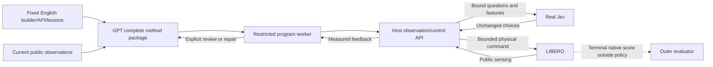

# GPT/Jev complete-method framework

## Active program interface v2

The actual builder is [gpt_jev_method_v2.txt](gpt_jev_method_v2.txt), supplied with
the [exact API manual](gpt_jev_program_api_v2.md) and
[generic development lessons](gpt_jev_method_lessons_v2.txt). Runtime task language,
images and public robot state are separate data. The fixed files contain no task
IDs, target coordinates, grasp trajectory or object-specific command recipe.

Generated or repaired methods must declare `api.review(..., fields=...)` for
every visual review. The [review contract compiler](../scripts/gpt_jev_review_contract.py)
turns concise type/enum declarations into strict function-tool parameters and
validates actual returns without coercion. Untouched explicitly selected archive
methods retain the legacy interface. Schema validity is separate from observation
truth and physical task success. Tool-schema numeric constraints stay exact;
model data uses the documented six-significant-digit wire representation.

GPT submits a complete `main(api)` source plus its explanation, interface and Jev
protocol. It owns observation processing, phase logic, geometric parameters,
Jev questions, bounded control leases, effect checks and recovery. The
[host](../scripts/run_gpt_jev_program.py) validates the package and runs it in a
[separate restricted worker](../scripts/gpt_jev_program_worker.py). Exact local
patches are assembled into a complete retained source before execution. A repair
starts a new Python namespace in the same physical scene; it does not reset motion.

The harness supplies public RGB-D/calibration, own robot geometry, finite-choice
Jev RPC, bounded OSC commands, observation reviews and a
[generic RGB-D patch registration primitive](../scripts/jev_rgbd_tracking.py).
The candidate worker also preloads a [pure numerical geometry library](../scripts/gpt_jev_geometry.py)
as `geo`; the exact manual lists its operations. It computes caller-selected
geometry without selecting observations, accepting a task, or controlling motion.
Its analytical and sandbox checks passed; native cold-builder evaluation is
tracked separately in the [continuation record](../../LOGS/2026-10-25-gpt-jev-stability.md).
It supplies no hidden object pose, segmentation identity, contact oracle, goal
predicate, task-dispatch branch or prewritten grasp/transfer policy. Every physical
update invokes real Jev, and raw choices and dispatched actions are retained.
Jev does not see dictionary question IDs: the compiler explicitly binds each
axis question to its state selector. The manual declares magnitude/deadband rules.

Native LIBERO evaluation is terminal and isolated from the generated method.
Executable source, reached poses, a tracked patch and a completion proposal are
separate from task success. Development failures, source revisions and acquisition
costs remain part of the evidence. One repeatedly observed development scene
reached native success after three same-scene GPT repairs. The first frozen
new-init probe failed during transfer tracking. A spatial feature-budget fix then
completed the same init and one frozen unused init with the unchanged method and
no repairs. A successful same-init wire comparison reduced completed-response
GPT inputs by 19.1%, but unknown retry usage prevents a full GPT cost comparison;
elapsed time was effectively unchanged. Multi-task stability remains untested.
The final fresh-builder request, with no archived task source, timed out at 1800
seconds before method delivery. Stable fast cold generation is not validated;
repair and reuse of a validated method are supported. A post-test absolute relay
deadline fix passed local fake-stream checks only. See the
[complete-method development report](../../LOGS/2026-10-24-gpt-jev-program.md).

October25 continuation: the exact previously generated source passed the
predeclared five unused initial states4-8 with native5/5 and zero source repairs,
30 GPT reviews /432 real Jev calls /1296 policy steps. This is small-scale reuse
reliability on one task. The distinct geo-assisted cold method delivered source
but failed after two GPT patches at23 Jev /69 steps. Precise partial-measurement,
historical-data ownership and control-receipt types have since been clarified;
independent cold and revision tests continue. See the
[continuation record](../../LOGS/2026-10-25-gpt-jev-stability.md). Completed token
totals exclude known unknown-usage retries; no full-cost or speedup claim follows.

Later typed development results: a fresh method, with no previous source input,
reached native success after one same-scene GPT patch (17 GPT /107 real Jev /
321 steps). A separate GPT-led revision also succeeded (11/106/318). Both full
episode usages are known; neither establishes net token savings or speedup.
The [complete generated method and Jev input/output protocol](../../artifacts/gpt-jev-typed-method-20261025/METHOD.md)
are preserved verbatim with source and provenance. The frozen9a3e framework
then obtained native1/2 on independently generated init9/10, each with three
automatic source repairs. Both completion proposals were false: one stopped
above the receiver on unknown tracking, the other completed placement but lacked
tracking evidence for stability. Planned init11-13 were not admitted after the
failure. The next251104e6 candidate requires phase-local observation recovery
and exact helper-key checks; its declared larger budget is reported separately.
No outer-agent task-source edits are used.

The observation-recovery candidate exposed a deterministic pre-action worker
defect: ndarray reductions required a cached NumPy internal module through the
calling frame's builtins. The minimal worker fix returns only explicitly named,
already loaded NumPy internals; it does not invoke general imports. Offline
seccomp and unchanged-source recorded-RPC checks passed. The new independent
cold cohort uses this fix; its native outcome is tracked in the continuation
record, separately from the two interrupted zero-action cases.

The same existing signed-in local Pro planner and separate authorized Jev routing
described below apply to v2. Neither Platform API credentials nor `caz/z` keys
are used. The v1 contract adapter remains available for comparison.

## Previous contract planner v1

The reusable prompt is `gpt_jev_planner_v1.txt`. It contains no task names,
task IDs, fixed manipulation recipes, demonstrations, or known trajectories.
Runtime task language and current RGB-D are separate inputs. Generated plans may
be task-specific: that is the planner's output, not a handwritten task policy.
This separation supports evaluation of generality; it does not establish it.

## Executable interface

`code/scripts/gpt_jev_contract.py` exports the exact `submit_plan` tool schema,
capability contract, recursive English-text check, data validator, and Jev request
builder. `code/scripts/run_gpt_jev_generic.py` interprets the resulting data.

1. GPT selects visible image anchors and their measurement patches.
2. Code measures median RGB-D depth and performs calibrated backprojection.
3. GPT stages specify a target expression, world rotation-vector adjustment,
   gripper requirement, minimum delivered steps, and visual review conditions.
4. At every control update Jev chooses all six motion signs, gripper action,
   and continue/advance/review/stop. Code supplies bounded magnitudes and OSC_POSE.
5. A local gate checks robot pose and command delivery only. GPT reviews actual
   before/after images for object effects, then regenerates a grounded local plan.
6. Native task evaluation is read only after policy termination.

No generated Python, `eval`, dynamic imports, arbitrary expression language,
task-ID dispatch, category/color segmentation heuristic, or physics preview is
used. The existing own-finger geometry helper supplies robot geometry only.
Visual-check strings are instructions for the next GPT review, not implemented
detectors. Checkpoint requests include only current/previous planning views and
the latest six acknowledged command receipts; complete raw receipts remain local.

## Limits and evidence

Depth patches may hit background, an occluder, or an unintended surface even if
depth is locally smooth. Anchor identity, occluded geometry, contact, retention,
collision avoidance, and completion are not certified by schema validation.
Anchors remain fixed until review; moving targets need renewed grounding.
The interpreter has no collision planner. Scope is bounded simulated manipulation.

Prompt and schema are frozen before selecting/running the first development
episode. One task tests integration and feasibility only. Generalization needs
held-out task families, objects, and layouts with no task-specific prompt edits.
Efficiency needs matched-success comparisons including all initial/review GPT
tokens, Jev tokens/calls, physical steps, failures, and elapsed time.

## Model routing

The planner uses the existing local signed-in ChatGPT transport, pinned to
`gpt-6-astra` / `xhigh`. It never uses a Platform API key. A separate user-authorized
Jev credential serves real `jev-1.13.0` at the official TypeSafe `/v1/systemone`
endpoint through the existing loopback relay. No OpenAI Decisions credential or
`caz/z` key is used. The remote executor accepts only the explicit port-7921
loopback relay, and stores request/response/dispatch records for auditing.

References: [OpenAI prompt engineering](https://developers.openai.com/api/docs/guides/prompt-engineering),
[Jev Choice](https://docs.typesafe.ai/primitives/choice),
[Jev 1.13 limitations](https://docs.typesafe.ai/model-jaggedness/jev-1.13).

## First development test, 2026-10-24

The fixed prompt and interpreter ran on company-server-2-ykj using LIBERO-Plus.
GPT generated all stages and anchors from runtime observations. The final episode
used seven GPT plans, 74 real Jev decisions and 222 control steps. All executed
choices matched their receipts, but GPT's `complete` claim disagreed with native
evaluation (`false`). This is executable integration evidence, not a successful
task result, a stability guarantee, a generalization result, or a token/speed gain.

See [the complete development report](../../LOGS/2026-10-24-gpt-jev-generic.md),
including the setup failure, zero-action review loop, and four-plan budget failure.
The tested control commit was `87516433`; the subsequent cancellation bookkeeping
fix does not change planning or action selection. No task recipe was added after
seeing the final failure. This adapter currently targets one LIBERO robot and
OSC_POSE; another robot needs a capability/observation/action adapter.
